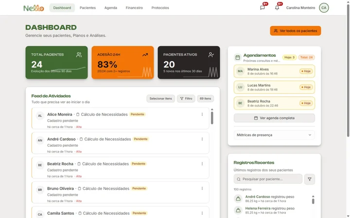

<p align="center"></p>

# Nello

**O consultório digital do nutricionista.** Gestão clínica, prescrição alimentar e acompanhamento do paciente, com agenda, comunicação e financeiro em uma plataforma.

[Acessar o Nello](https://nellonutri.com.br) · [Versões](https://github.com/viniflix/nello/releases) · [Planejamento](https://github.com/viniflix/nello/milestones) · [Tarefas](https://github.com/viniflix/nello/issues) · [Quadro](https://github.com/users/viniflix/projects/2)

[](https://github.com/viniflix/nello/actions/workflows/quality.yml)
[](https://github.com/viniflix/nello/actions/workflows/backend-reconstruction.yml)
[](https://github.com/viniflix/nello/actions/workflows/production-observation.yml)

## O produto

| Experiência | Funcionalidades |
|---|---|
| Nutricionista | Pacientes e prontuário, anamnese, avaliações, exames, metas e plano alimentar; modelos, receitas, check-ins, chat, agenda e financeiro. |
| Paciente | Plano prescrito, diário alimentar, check-ins, evolução, conquistas, perfil e comunicação com o profissional. |
| Administração | Gestão de usuários, operação do produto, relatórios e acompanhamento técnico. |

O Nello está em evolução contínua. Uma entrega técnica validada não substitui avaliação clínica, pesquisa com usuários ou comprovações dos serviços externos. As tarefas distinguem melhorias planejadas, hipóteses em investigação e dependências externas.

<details>
<summary>Conheça a interface</summary>



Imagem demonstrativa já usada na apresentação pública do produto; não representa o estado atual de uma conta real.

</details>

## Tecnologia e organização

React 18, Vite, React Router, Tailwind CSS 3 e Radix UI compõem a interface. React Query, React Hook Form e Zod apoiam consultas e formulários; Recharts e Framer Motion oferecem visualização e movimento. O backend usa PostgreSQL/Supabase, Auth, Storage, Realtime e Edge Functions. Sentry e PostHog apoiam a observabilidade com filtros de privacidade.

| Caminho | Responsabilidade |
|---|---|
| `src/` | Interface, domínios, aplicação e integrações. |
| `api/` | Endpoints da plataforma de hospedagem. |
| `supabase/` | Contratos, migrações e funções do backend. |
| `e2e/` | Jornadas e referências visuais com dados fictícios. |
| `scripts/` | Validação, reconstrução, observabilidade e ferramentas de entrega. |
| `operations/` | Contratos operacionais versionados. |
| `public/` | Assets públicos da aplicação. |
| `.github/` | Workflows e modelos de tarefas. |

## Desenvolvimento local

Use a versão de Node indicada em [.nvmrc](.nvmrc) e o npm fixado em [package.json](package.json). O instalador do projeto prepara o gerenciador e instala a árvore do lockfile:

```sh
node scripts/release/install.mjs
npm run dev
```

Configure `.env.local` com as variáveis públicas exigidas pelo cliente, usando apenas um ambiente local descartável para testes:

```dotenv
VITE_SUPABASE_URL=<url-do-ambiente-local>
VITE_SUPABASE_ANON_KEY=<chave-publica-do-ambiente-local>
```

Variáveis `VITE_*` são incorporadas ao frontend: nunca coloque senhas, tokens administrativos ou chaves privadas nelas. Arquivos de ambiente e credenciais não são versionados. Configuração de observabilidade e CAPTCHA depende da jornada que será exercitada; não reutilize credenciais de produção para fixtures.

## Validação e publicação

```sh
npm run test:run       # Testes automatizados
npm run build          # Build, licenças e lint
npm run verify:release # Gate completo antes de mudanças no produto
```

O gate verifica dependências, contratos de backend, licenças, estrutura, arquitetura, tipos, lint, testes/cobertura, build, orçamento de bundle e política de segurança. A aprovação de uma exceção revisada não significa ausência de todos os avisos de dependências.

Desenvolvimento na **main**, com mudanças pequenas, validação local e deploy direto. Após publicar uma mudança no produto, conferir todos os workflows do SHA, deployment canônico e jornadas afetadas. CI verde, isoladamente, não certifica produção.

Os testes usam dados fictícios e ambientes descartáveis. O workflow de reconstrução não aplica SQL em produção. Para trabalhar no backend, consultar o [contrato de reconstrução](operations/backend/README.md); não executar `db push` indiscriminadamente sobre migrações legadas.

## Como acompanhar as entregas

- **Issues:** tarefas com objetivo, classificação e critérios de conclusão.
- **Milestones:** conjuntos de objetivos; sem prazo artificial para condições externas.
- **Projects:** andamento do trabalho; o quadro do proprietário pode exigir acesso autorizado.
- **Releases e tags:** marcos do produto, vinculados ao commit da entrega. O versionamento editorial usa `release-AAAA.MM.DD.N`, sem alterar a versão do pacote ou a correlação por SHA.
- **Deployments e Actions:** registros técnicos individuais, preservados para rastreabilidade.

As notas de versão descrevem o conjunto de melhorias, validações e limites relevantes. Não é necessário criar uma Release para cada deploy. Tags publicadas não devem ser movidas para outro commit.

## Privacidade e licença

Não publique dados de pacientes, informações clínicas, credenciais, logs privados ou comprovantes internos em issues, comentários ou anexos. Possíveis vulnerabilidades devem ser tratadas pelo canal privado de [relato de segurança](https://github.com/viniflix/nello/security), quando disponível; nunca exponha provas sensíveis em uma issue pública.

Planos, checkpoints, evidências e instruções internas permanecem locais e ignorados pelo Git, com backup privado. Este repositório contém o código e a apresentação pública do projeto.

Projeto proprietário de **Vinicius Costa**. Consulte [LICENSE](LICENSE) e [THIRD_PARTY_NOTICES.md](THIRD_PARTY_NOTICES.md).
